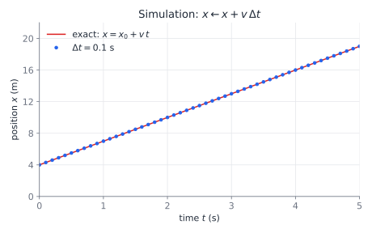

# Uniform motion in one dimension

"Uniform" motion means the **velocity is constant**: the same speed, always in the same direction. Because nothing about the motion changes over time, people sometimes also call it "steady." The object covers equal distances in equal time intervals.

## The setup

- Motion happens along a single axis, which we call $x$.
- $x(t)$ is the position at time $t$, measured from some chosen origin.
- $v$ is the velocity. It is a signed number: positive means moving toward +x, negative means moving toward −x.

## The equations

### 1. Velocity is constant

$$v = \text{const}$$

This is the definition of uniform motion.

### 2. Position is a linear function of time

$$x(t) = x_0 + v\thinspace t$$

- $x_0$ is the position at $t = 0$, the starting point.
- $v\thinspace t$ is how far the object has moved since then.

If the clock starts at some time $t_0$ instead of 0:

$$x(t) = x_0 + v\thinspace(t - t_0)$$

### 3. Displacement and velocity

$$\Delta x = v\thinspace\Delta t \qquad\Longleftrightarrow\qquad v = \frac{\Delta x}{\Delta t}$$

When velocity is constant, the **average velocity equals the velocity at every moment**. That is why the simple "distance ÷ time" formula is exact here. For non-uniform motion it only gives an average.

## Worked example

A car is at $x_0 = 4\text{ m}$ at $t = 0$ and moves at $v = 3\text{ m/s}$ (toward +x).

- Position: $x(t) = 4 + 3t$
- At $t = 3\text{ s}$: $x = 4 + 9 = 13\text{ m}$
- It reaches $x = 16\text{ m}$ when $16 = 4 + 3t$, so $t = 4\text{ s}$.

## Graphs

### Position vs time


- The graph is a **straight line**.
- Where it starts on the vertical axis is the starting position: $x_0 = 4\text{ m}$.
- Its **slope** is the velocity: $v = \Delta x / \Delta t = 3\text{ m/s}$. The line goes up because $v$ is positive; with a negative $v$ it would go down. A steeper line means faster motion.

### Velocity vs time


- The graph is a **horizontal line** at height $v$, because velocity doesn't change.

The graphs are generated by [graphs.py](graphs.py). From the repo root, run `.venv/bin/python p01-uniform_motion/graphs.py`.

## Animation

**[▶ Open the interactive animation](https://lorand77.github.io/learning_physics/p01-uniform_motion/uniform_motion.html)**

A car moves along the x axis while dots trace its position and velocity on the x–t and v–t graphs in real time. Use the sliders to change $x_0$ and $v$ (try a negative $v$), or drag the time slider to scrub through the motion.

The source is [uniform_motion.html](uniform_motion.html), a single file with no dependencies.

## Simulation

A computer doesn't use the formula $x(t) = x_0 + v\thinspace t$ directly. It moves time forward in small steps of $\Delta t$ and updates the position on each step:

```python
while t < t_end:
    x = x + v * dt
    t = t + dt
```

Each step adds the displacement $v\thinspace\Delta t$ for that small interval.



- Each step moves time forward by $\Delta t$ and the position by $v\thinspace\Delta t$. With $\Delta t = 0.1\text{ s}$ that is 0.3 m per step.
- For uniform motion the simulated points land **exactly** on the line $x_0 + v\thinspace t$, whatever the size of $\Delta t$. The velocity never changes, so every step adds exactly the right distance. This stops being true once there is acceleration: then a smaller $\Delta t$ gives a more accurate answer.

**[▶ Open the step-by-step simulation](https://lorand77.github.io/learning_physics/p01-uniform_motion/simulation.html)**: step through the loop one $\Delta t$ at a time, see the code with the numbers filled in, and change $\Delta t$.

The plot and the step table are produced by [simulate.py](simulate.py). From the repo root, run `.venv/bin/python p01-uniform_motion/simulate.py`. The interactive page is [simulation.html](simulation.html).

## Common pitfalls

- **Distance vs. displacement:** Δx can be negative, but distance traveled is $|v|\thinspace\Delta t$. In uniform motion the direction never reverses, so distance $= |\Delta x|$.
- **Speed vs. velocity:** speed is $|v|$, and velocity carries a sign.
